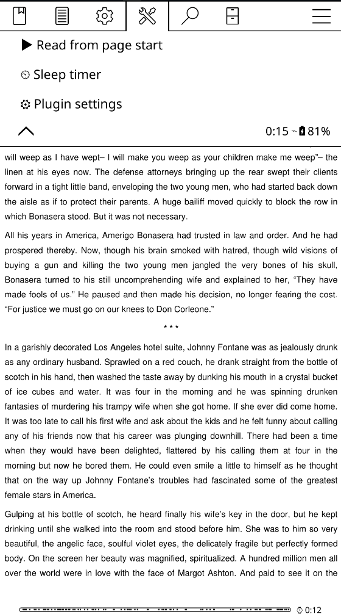
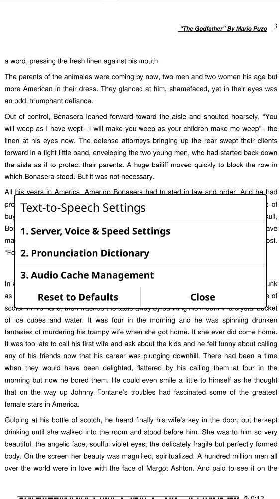

# KOReader TTS Plugin

High-performance Text-to-Speech (TTS) plugin for [KOReader](https://github.com/koreader/koreader), powered by a native Rust engine (`libtts_core.so`) and compatible with any OpenAI-compatible speech endpoint (`POST /v1/audio/speech`).

---

## Features

- **Non-blocking Native Core**: Offloads network I/O, HTTP/2 connection pooling, and audio decoding (OPUS, MP3, FLAC, WAV) to background threads via LuaJIT FFI, completely eliminating UI lag.
- **E-ink Sentence Highlighting**: Real-time 20% soft gray highlight matching KOReader's native text selection, using partial screen refresh.
- **Cross-page Stitching**: Automatically joins sentences split across page boundaries for natural, continuous speech without mid-sentence cutoffs.
- **Floating Controls**: Bottom-anchored control bar with live buffer status, speed cycling (0.5x–2.0x), and a minimizable floating bubble mode.
- **Built-in Utilities**: In-app pronunciation dictionary (custom word replacements), sleep timer, and session resume.

---

## Technical Architecture

The plugin splits work between a lightweight **UI layer (Lua)** and a high-performance **background engine (Rust)**:

```text
┌──────────────────────┐         ┌──────────────────────┐         ┌──────────────────────┐
│     KOReader UI      │ ──────▶ │   Playback Queue     │ ──────▶ │     E-ink Screen     │
│  (Buttons & Player)  │         │ (Sentence Management)│         │ (Sentence Highlight) │
└──────────────────────┘         └──────────┬───────────┘         └──────────────────────┘
                                            │
                                            │ LuaJIT FFI
                                            ▼
┌────────────────────────────────────────────────────────────────────────────────────────┐
│                              Rust Native Core (Background)                             │
│                                                                                        │
│   ┌────────────────────┐     ┌────────────────────┐     ┌──────────────────────────┐   │
│   │   Network Engine   │ ──▶ │   Audio Decoder    │ ──▶ │       Audio Output       │   │
│   │ (HTTP/2 & Preload) │     │ (OPUS / MP3 / WAV) │     │ (Speaker / Bluetooth BT) │   │
│   └────────────────────┘     └────────────────────┘     └──────────────────────────┘   │
│             │                                                                          │
│             ▼                                                                          │
│   ┌────────────────────┐                                                               │
│   │ Disk/Memory Cache  │                                                               │
│   │ (Instant Playback) │                                                               │
│   └────────────────────┘                                                               │
└────────────────────────────────────────────────────────────────────────────────────────┘
```

- **Zero UI Freezes**: All network calls, audio decoding, and file caching run on background OS threads via Rust (`libtts_core.so`), keeping the KOReader interface 100% responsive.
- **Smart Preloading**: Downloads upcoming sentences in the background so audio plays continuously from sentence to sentence without pauses.
- **Audio Caching**: Audio clips are cached locally so repeating a sentence or re-reading a page plays instantly without network requests.

---

## Installation

Copy the `koreader_tts.koplugin` folder into your device's KOReader plugins directory:

| Platform | Path | Device Verification Status |
| :--- | :--- | :--- |
| **Android (E-ink & Mobile)** | `/sdcard/koreader/plugins/` | **Verified on real hardware**: Onyx Boox Palma (Android 11, `arm64-v8a`) & Android emulator (`x86`/`arm64`) |
| **Kindle / Kobo** | `/mnt/us/` or `/.kobo/` | *Untested on physical hardware* (requires musl/armhf cross-compilation) |
| **Linux Desktop** | `~/.config/koreader/plugins/` | Verified for automated unit & acceptance testing only |

Restart KOReader, then go to **Settings (Gear)** ➔ **Plugin management** and enable **koreader_tts**.

---

## Configuration

1. In KOReader, tap Top Menu ➔ **Text-to-Speech** ➔ **Plugin settings**.
2. Configure your speech server:
   - **Server URL**: `https://api.openai.com/v1/audio/speech` (or self-hosted `http://<ip>:8000/v1/audio/speech`).
   - **API Key**: Enter your OpenAI API key (`sk-...`), or leave blank for local servers without auth.
   - **Voice**: e.g. `alloy`, `echo`, `nova`.
3. Tap **Start reading from here** to start listening.

---

## Screenshots

<p align="center">
  
  
</p>

<p align="center">
  
  
</p>

---

## Build & Test

```bash
make test     # Run all Rust (30) and Lua (27) unit tests
make package  # Package plugin into dist/koreader_tts.koplugin
```

---

## License

Released under the [GNU General Public License v3.0](https://www.gnu.org/licenses/gpl-3.0.html).
